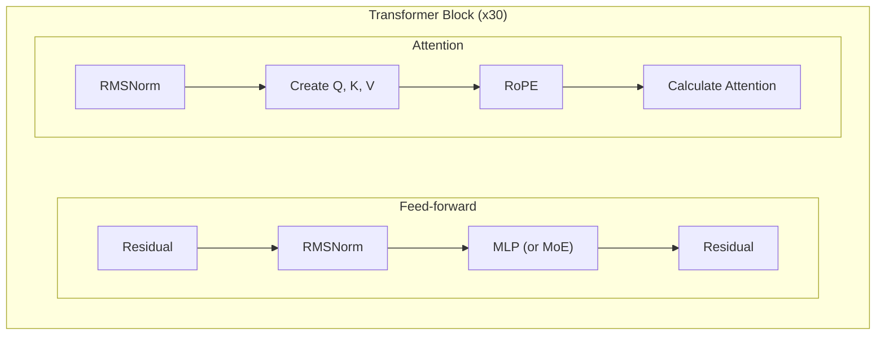

I wrote this article under the assumption that the reader has basic inference knowledge but maybe with some conceptual gaps. It is my goal, not to teach you inference from scratch (Philip Kiely is much better at this), but rather to make each step of inference more intuitive. Thus, the following implementation is very naive.

---

## **Step 0: Explore SmolLM2-135M**

As the honorable Abraham “Honest Abe” Lincoln, esteemed 16th President of the United States, preserver of the Union, and author of the Emancipation Proclamation once said: “To optimize your generative AI model’s performance in production, you must first understand it.”

Heeding his advice, we shall begin our journey by exploring SmolLM2-135M’s config.

```python
smollm2.config
```

```
LlamaConfig {
  "architectures": [
    "LlamaForCausalLM"
  ],
  "attention_bias": false,
  "attention_dropout": 0.0,
  "bos_token_id": 0,
  "dtype": "float32",
  "eos_token_id": 0,
  "head_dim": 64,
  "hidden_act": "silu",
  "hidden_size": 576,
  "initializer_range": 0.041666666666666664,
  "intermediate_size": 1536,
  "is_llama_config": true,
  "max_position_embeddings": 8192,
  "mlp_bias": false,
  "model_type": "llama",
  "num_attention_heads": 9,
  "num_hidden_layers": 30,
  "num_key_value_heads": 3,
  "pad_token_id": null,
  "pretraining_tp": 1,
  "rms_norm_eps": 1e-05,
  "rope_interleaved": false,
  "rope_parameters": {
    "rope_theta": 100000,
    "rope_type": "default"
  },
  "tie_word_embeddings": true,
  "transformers_version": "5.18.0",
  "use_cache": true,
  "vocab_size": 49152
}
```

Some useful things to note:

- SmolLM2-135M has roughly 135M parameters. When loaded in FP32, each parameter is stored in 4 bytes, so the parameters alone occupy roughly 540MB of GPU VRAM. Total VRAM usage is higher because of intermediate tensors, the KV cache, and other overhead.
    - The published configuration for SmolLM2-135M specifies BF16 (similar to FP16 but the individual bits are assigned differently). I chose to load the parameters as FP32 instead to decrease additional rounding errors in later calculations (converting BF16 weights to FP32 does not recover precision already lost in the stored weights). The obvious downside to loading each parameter with twice as many bits is using twice as much memory, but for the purpose of this blog, sacrificing memory for precision is worth it (and also illustrative of the precision-memory tradeoff inference engineers typically face).
- SmolLM2-135M’s vocabulary is nearly 50,000 tokens long.
- Each token’s embedding vector has 576 features. SmolLM2-135M uses 9 query attention heads with 64 features per head (9 * 64 = 576). Interestingly, there are only 3 key heads and 3 value heads, paired into 3 key-value heads. Each key-value head is shared by 3 query heads. We will understand why this discrepancy exists shortly (hint hint: its GQA).
- The model has 30 hidden layers (transformer blocks) and uses SiLU as its activation function within each transformer block’s feedforward network.
- SmolLM2-135M uses causal attention, meaning each token’s representation can incorporate information only from itself and previous tokens. This representation is then used to predict the next token.

---

## **Step 1: Tokenization**

Now that we understand our model a little better, it’s time to actually give it some text to respond to!

I’m a huge self-proclaimed cinephile and my favorite movies are thrillers with plot twist endings. I’m curious to know what SmolLM2 thinks the greatest movie plot twist of all time is (it’s obviously The Prestige by Christopher Nolan).

To get our answer, we need to first call the model’s subword tokenizer to split up the input and give us each chunk’s token id.

```python
input_string = "The movie with the greatest plot twist ever is"
token_ids = tokenizer(input_string, return_tensors="pt")["input_ids"].to("cuda")
```

```python
# token_ids
tensor([[  504,  7704,   351,   260,  6250,  5049, 10258,  2042,   314]])
# token_ids.shape
torch.Size([1, 9])
```

The tokenizer runs on CPU and then moves the token id tensor to GPU VRAM. Also note that token ids carry no semantic meaning whatsoever. They are purely information about where that token falls in the model’s vocab, so “cat” and “Cat” and “ cat” do not necessarily have similar token ids.

The token ids corresponding to our input sequence are stored in a matrix with dimension 1 x 9. We generalize the dimensionality of a token id tensor to B x T, where:

B = batch size

T = # of tokens in the batches’ input sequences

Batch size refers to the number of prompts the model processes at once. When you ask ChatGPT a question, it is highly unlikely you are the only person in the world asking it a question at that time. Often, production models must process several prompts at once. Tensors must be rectangular, so the logical question that follows is, “What if requests in the same batch have different sized inputs?” This introduces the concept of padding, which I’ve written a small blurb about in the TLDR Appendix. We will begin by processing a batch of size one for simplicity.

---

## Step 2. Prefill

When you prompt a model, it needs to process your input so it can generate a response. Prefill is the process that looks up the embeddings for our 9 input tokens, passes those embeddings through all 30 transformer blocks, stores each layer’s keys and values in the KV cache, and computes the logits used to predict the first output token. Prefill is followed by decode, the step that autoregressively generates subsequent tokens, reusing the cached keys and values from previous tokens.

### 2a. Embedding

After tokenizing, we need to retrieve the embedding vector for each token from the input. First, we get the model’s embedding table which stores the embedding vector for every token in its vocabulary. Thus, the table should have the following dimension: vocab size x hidden state size, or 49,152 x 576.

```python
# The embedding table's shape is 49,152 x 576:
embedding_table = smollm2.model.embed_tokens.weight.data
```

Then, we grab specifically our input token ids’ corresponding embedding vectors only.

```python
X = embedding_table[token_ids]
print(X)
print(X.shape)
```

```python
tensor([[[ 0.1177,  0.0199, -0.0942,  ...,  0.0405,  0.1182,  0.0762],
         [ 0.0101,  0.0771, -0.0981,  ..., -0.0398,  0.2480,  0.0571],
         [ 0.0894,  0.0045,  0.0874,  ...,  0.0342, -0.0164, -0.0762],
         ...,
         [-0.0183,  0.0718, -0.0160,  ..., -0.1060,  0.1123, -0.0393],
         [-0.1699,  0.1348,  0.0820,  ...,  0.0109, -0.0118, -0.0811],
         [-0.0522,  0.0179, -0.0613,  ...,  0.1455,  0.0889, -0.0452]]],
       device='cuda:0')
torch.Size([1, 9, 576])
```

We’ve successfully selected the embedding vectors for our input token ids. Sanity checking the dimensions, we see we have a 3 dimensional input tensor, X, for our next transformer block: 1 x 9 x 576 or B x T x D.

### 2b. Transformer Block

We now have a tensor with the embedding vector of each input token in our batch. These embeddings carry some semantic information about their tokens, but they’re context independent. Thus, we pass each token’s embedding through a series of transformer blocks, 30 in this case, to enrich each embedding with additional information.

The following is my rough mental model for transformer blocks:



Note: SmolLM2-135M is not MoE, but MoE has become dominant in modern frontier-scale LLMs.

#### i. RMSNorm

First, let's develop some intuition as to why we need to normalize our vectors and why we use RMS specifically.

In a few steps, we'll have to apply softmax to get attention scores. Softmax exponentiates its inputs, so the gaps between them get amplified: 6 vs. 5 isn't a huge deal ($e^6$ is only ~2.7x $e^5$), but 60 vs. 50 is ($e^{60}$ is ~22,000x $e^{50}$). That's why it's necessary to control the magnitude of the vectors going into the transformer block. Our hidden states are used to create Q and K, and attention scores are the dot products between them. If a hidden state is 10x larger, Q and K are each 10x larger, so the attention scores end up 100x larger. For example, if a token's attention scores were [1, 2, 3], attention would be spread fairly evenly across the three tokens. If they were [10, 20, 30] (same direction, larger magnitude), the bulk of attention would go to the third token. This is only one reason we normalize, and also note that we are not discarding the original representation of each token, but rather enriching it with additional information (this will become apparent when we reach our residual step).

$$
\operatorname{RMSNorm}(x)=\frac{x}{\sqrt{\frac{1}{D}\sum_{i=1}^{D}x_i^2+\epsilon}}\odot\gamma
$$

We normalize each token's hidden state with RMS because we want to find the typical magnitude of an element in each vector, and squaring each element prevents negative terms from cancelling positive terms (the mean of [-3, 0, 3] is 0, but the typical magnitude of an element should be higher). Thus, for RMS, we square each element, add the squares, divide by the total number of elements (D), add a very small epsilon to prevent division by 0, and take the square root. We then divide each element in the vector by the RMS. Finally, we compute elementwise multiplication with gamma, a learned weight vector.

```python
layer0 = smollm2.model.layers[0]
rms_weight = layer0.input_layernorm.weight.data

def rms_norm(X: torch.Tensor, weight: torch.Tensor, eps=config["rms_norm_eps"]) -> torch.Tensor:
  X32 = X.float()
  rms = torch.sqrt(X32.pow(2).mean(dim=-1, keepdim=True) + eps)
  return weight * (X32 / rms).to(X.dtype)

H = rms_norm(X, rms_weight)
```

#### ii. Creating Q, K, V

We now create our Q, K, and V matrices.

Q = what information am I looking for

K = what information can I be found by

V = what information can I actually provide

An analogy I like to think of is Yashi’s movie streaming service. Imagine we have a small dictionary catalog (that doesn’t require hashable keys or proper syntax) of some of my favorite movies:

Movie Catalog: {

{genre: thriller, actor: Christian Bale, runtime: 130}: the_prestige.mov},

{genre: romcom, actor: Heath Ledger, runtime: 97}: 10_things.mov},

{genre: scifi horror, actor: Jake Gyllenhaal, runtime: 104}: life.mov},

}

Tonight, I feel like watching a comedy movie around 90 minutes long with Adam Sandler. I pass in my query, the information I’m looking for, as: {genre: comedy, actor: Adam Sandler, runtime: 90}. The streaming service takes my query and compares it against each key to find the closest match. There’s no exact match, but the closest movie to what I’m looking for is 10 Things I Hate About You. Now that we know what movie is closest to what I want, the streaming service hands me the 10_things.mov file (the value) so that I can actually watch the movie.

We create Q, K, V by multiplying our matrix by learned weights $W_q$, $W_k$, $W_v$.

$Q = XW_q$

$K = XW_k$

$V = XW_v$

Note that our input tensor was a 3D tensor that contains several (unless the batch size is 1) matrices inside. Each inner matrix is multiplied by the learned projections.
